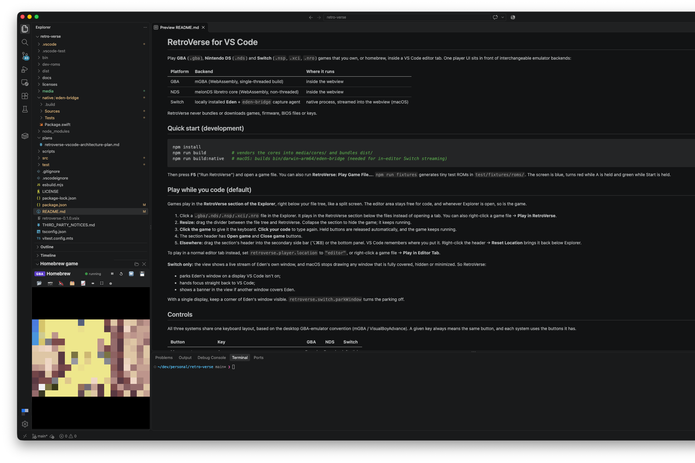

# RetroVerse for VS Code

[](https://github.com/avishayil/retro-verse/actions/workflows/ci.yml)
[](https://github.com/avishayil/retro-verse/releases/latest)
[](LICENSE)

RetroVerse plays Game Boy Advance, Nintendo DS and Nintendo Switch games inside VS Code. The game runs in a
section of the Explorer, below your files, so you can keep coding in the editor next to it.



Website: <https://avishayil.github.io/retro-verse/>

| System | Files | Emulator | Where it runs |
|---|---|---|---|
| Game Boy Advance | `.gba` | mGBA (WebAssembly) | inside VS Code |
| Nintendo DS | `.nds` | melonDS (WebAssembly) | inside VS Code |
| Nintendo Switch | `.nsp`, `.xci`, `.nro` | Eden, installed separately | Eden's window, streamed into VS Code (macOS) |

RetroVerse does not include or download any games, BIOS files, firmware or keys. Use homebrew or games you own.

## Install

1. Download `retroverse.vsix` from the [latest release](https://github.com/avishayil/retro-verse/releases/latest).
2. Install it from a terminal:

   ```sh
   code --install-extension retroverse.vsix
   ```

   Or open the Extensions view in VS Code, click the `...` menu and choose **Install from VSIX...**.
3. Reload VS Code.

You need VS Code 1.95 or later. GBA and DS games run inside VS Code and do not use the capture agent. Switch
streaming needs macOS on Apple Silicon, because the capture agent uses ScreenCaptureKit and VideoToolbox.
RetroVerse has so far been tested on macOS only.

## Play while you code

Click a game file in the Explorer. Instead of opening an editor tab, the game starts in the RetroVerse section at
the bottom of the Explorer. You can also right-click a game file and choose **Play in RetroVerse**.

Drag the divider above the section to give the game more room. Collapse the section to hide it; the game keeps
running. The section header has buttons to open another game and to close the current one.

Click the game to give it the keyboard, and click your code to type again. RetroVerse releases any held buttons
when the game loses focus.

You can drag the section into the secondary side bar (⌥⌘B) or the bottom panel, and VS Code remembers the new
place. Right-click the header and choose **Reset Location** to move it back. To play in an editor tab instead,
set `retroverse.player.location` to `"editor"` or right-click a game and choose **Play in Editor Tab**.

## Controls

All three systems use one keyboard layout, based on the layout of desktop GBA emulators such as mGBA and
VisualBoyAdvance. A key means the same button on every system.

| Button | Key | GBA | DS | Switch |
|---|---|:-:|:-:|:-:|
| Movement | Arrow keys | D-pad | D-pad | Left stick |
| D-pad on Switch | I, J, K, L | | | yes |
| A / B | X / Z | yes | yes | yes |
| L / R | A / S | yes | yes | yes |
| Y / X | C / V | | yes | yes |
| ZL / ZR | Q / W | | | yes |
| Start (+) | Enter | yes | yes | yes |
| Select (-) | Backspace or Right Shift | yes | yes | yes |
| Home | H | | | yes |
| Turbo (fast-forward) | Hold Tab, or Shift+Tab to toggle | yes | yes | yes |
| Quick save / quick load | F5 / F8 | yes | yes | |

Switch games move with the left stick, so on Switch the arrow keys drive the stick and the D-pad moves to I, J, K
and L. W, A, S and D are not movement keys, because A and S are already L and R.

Gamepads with the standard mapping work without setup, with face buttons mapped by position as on a Nintendo
controller. On the DS, use the mouse on the touch screen as the stylus. To change a key, set
`retroverse.input.keyboard`, for example `{ "A": "KeyK" }`. The **Keys** button in the player toolbar shows the
current layout.

Turbo runs GBA and DS games at the speed in `retroverse.player.turboSpeed` (2 to 8 times, default 3). On Switch,
RetroVerse presses Eden's own "Toggle Turbo Speed" hotkey, so Eden's turbo speed setting applies.

## Switch games with Eden

RetroVerse does not include a Switch emulator. Install [Eden](https://eden-emu.dev) yourself. RetroVerse looks for
`eden-cli` on your `PATH`, then for `Eden.app` in `/Applications` and `~/Applications`. If Eden is somewhere else,
set `retroverse.switch.edenPath`.

When you open a Switch game, RetroVerse starts Eden and a small capture agent called `eden-bridge`. The agent
records Eden's window and audio, encodes the video as H.264 and sends it to VS Code over a WebSocket on
`127.0.0.1` that requires a per-session token. Your keyboard or gamepad input goes back to Eden as key presses.
RetroVerse reads which keys to press from Eden's own keyboard bindings, so changes you make in Eden apply on the
next launch.

The first time, macOS asks you to allow VS Code two permissions in System Settings, under Privacy & Security.
Screen Recording is needed for the picture and sound, and Accessibility for input. Until both are allowed, Eden
runs in its own window and the RetroVerse section shows buttons that open the right settings page. Switch games
only start in a trusted workspace.

macOS stops drawing a window that is covered, hidden or minimized, which would freeze the stream. RetroVerse
moves Eden's window to a display that VS Code is not on, gives focus back to VS Code, and shows a notice if
another window covers Eden. With a single display, keep part of Eden's window visible.
`retroverse.switch.parkWindow` turns off the window move.

Some details about how RetroVerse runs Eden:

- On macOS it sets `MVK_CONFIG_SYNCHRONOUS_QUEUE_SUBMITS=1` and `MVK_CONFIG_VK_SEMAPHORE_SUPPORT_STYLE=0` for
  Eden. These MoltenVK settings avoid a `VK_ERROR_DEVICE_LOST` crash. You can change or remove them with
  `retroverse.switch.environment`.
- If Eden's GDB stub is turned on, Eden waits on "Launching..." until a debugger continues it. By default
  RetroVerse connects to the stub and lets the game run. Set `retroverse.switch.gdbStub` to `"leave"` if you want
  to attach your own debugger. Eden's stub listens on all network interfaces, so turn it off when you are not
  debugging.
- Pause suspends the Eden process and Reset restarts it. Closing the game stops Eden and the capture agent.
- Switch has no save states in RetroVerse. Use the game's own save. **Open Mods Folder** opens Eden's `load`
  folder.

## Saves

RetroVerse stores battery saves and save states for GBA and DS games in VS Code's extension storage, in a folder
named after the SHA-256 hash of the game file. Renaming or moving a game file keeps its saves. Writes are atomic,
so an interrupted save does not corrupt the previous one. Set `retroverse.storage.savesDirectory` to keep saves
somewhere else, and use **RetroVerse: Open Saves Folder** to find them. Switch saves stay in Eden.

## Commands and settings

The Command Palette has RetroVerse commands to play a game file, pause, resume, reset, stop, quick save, quick
load, open the saves or mods folder, open the settings and show diagnostics. Search for `retroverse` in the
Settings editor to see every option.

## Troubleshooting

Run **RetroVerse: Show Diagnostics**. It writes what RetroVerse found (emulator cores, Eden, the capture agent,
running sessions) to the RetroVerse output channel, with file names replaced by short hashes.

If the RetroVerse section is missing from the Explorer, right-click any Explorer section header and turn on
RetroVerse, or right-click the RetroVerse header and choose **Reset Location**.

If a Switch game stays on "Launching...", check the RetroVerse output channel. A message about the GDB stub port
usually means another copy of Eden is still running.

## Build from source

```sh
npm install
npm run build          # copies the emulator cores into media/cores and bundles the extension
npm run build:native   # macOS only: builds the eden-bridge capture agent
npm test
```

Press F5 in VS Code to start a development window. [CONTRIBUTING.md](CONTRIBUTING.md) covers the tests and the
project layout, and the `docs` folder describes the architecture, protocols and security model.

## License and legal notice

RetroVerse is licensed under the GNU General Public License v3.0 or later. It includes mGBA (MPL-2.0) and
melonDS (GPL-3.0); see [THIRD_PARTY_NOTICES.md](THIRD_PARTY_NOTICES.md).

RetroVerse is not affiliated with or endorsed by Nintendo. Game Boy Advance, Nintendo DS and Nintendo Switch are
trademarks of Nintendo. The project does not provide games, BIOS files, firmware or keys, and you are responsible
for using only content you have the right to use.
